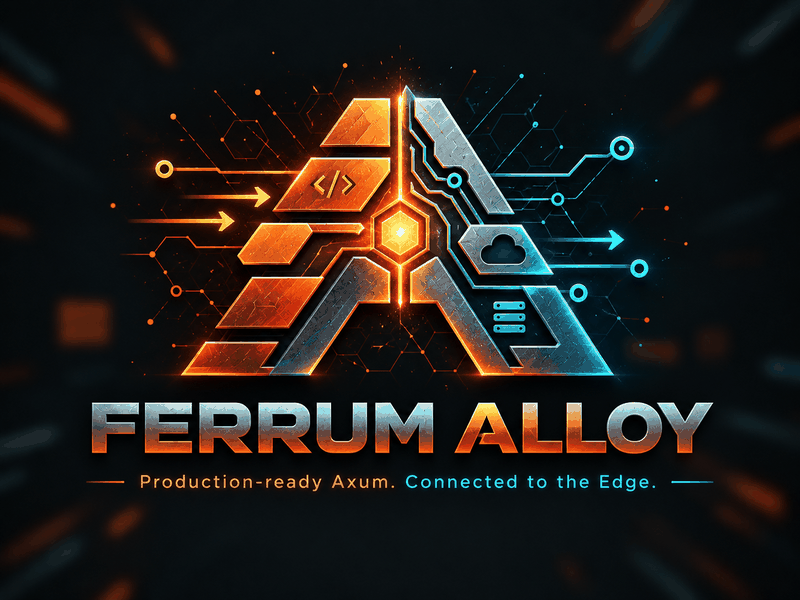

<p align="center">
  
</p>

<h1 align="center">Ferrum Alloy</h1>

<p align="center"><b>Production-ready Axum. Connected to the Edge.</b></p>

<p align="center">
  <a href="https://github.com/ferrum-edge/ferrum-alloy/actions/workflows/ci.yml"></a>
  <a href="https://github.com/ferrum-edge/ferrum-alloy/blob/main/LICENSE"></a>
  
  
  <a href="https://docs.rs/axum"></a>
  
</p>

Ferrum Alloy is a batteries-included toolkit for Rust API services built on [Axum](https://docs.rs/axum). It takes care of the repetitive production setup: configuration, errors, health, limits, graceful shutdown, and request telemetry. Handlers, extractors, state, routers, and Tower middleware stay ordinary Axum.

Alloy works on its own. Behind [Ferrum Edge](https://github.com/ferrum-edge/ferrum-edge), it also shows a verified request story shared with the gateway. You can see which gateway span each service span belongs to and whether the gateway's identity was cryptographically verified. You can also see what the evidence does and does not prove about where the time went.

> **v0.1.0, Git-only.** Alloy is distributed from Git tags and is not published to crates.io or any other registry (see the [distribution decision](docs/release.md#distribution-decision)). Before 1.0, Rust APIs may change in any minor release. The shared diagnostic-report and service-manifest v1 wire contracts have an accepted canonical freeze (see [Contracts](#contracts)). [Implementation status](docs/implementation-status.md) lists exactly what is implemented and tested.

## Quick start

```rust
use axum::{Router, routing::get};
use ferrum_alloy::AlloyApp;

async fn hello() -> &'static str {
    "Hello from Ferrum Alloy"
}

#[tokio::main]
async fn main() -> Result<(), Box<dyn std::error::Error>> {
    let router = Router::new().route("/hello", get(hello));

    AlloyApp::new("hello-api").router(router).run().await?;

    Ok(())
}
```

You can adopt it in two ways:

| | How |
|---|---|
| **New service** | Run `ferrum-alloy new orders-api`, or use `AlloyApp` directly. |
| **Existing Axum app** | Add only `ferrum-alloy-telemetry`, a Tower layer. You keep your runtime, subscriber, router, and server. |

To go further, read [Getting started](docs/getting-started.md).

## Features

| Area | What you get |
|---|---|
| **Configuration** | Typed and strict. Precedence is builder, then `FERRUM_ALLOY_*`, then TOML, then defaults. Secrets are redacted. See [configuration](docs/configuration.md). |
| **Errors** | RFC 9457 Problem Details for framework errors and Problem-returning extractors. Application bodies are never rewritten. |
| **Health** | Minimal liveness, cached single-flight readiness, and a draining state. Detailed management health always requires a configured operator token, even on loopback. |
| **Limits & lifecycle** | Body, header, connection, and admission limits. A deadline on time to response headers, which never cuts SSE streams. SIGTERM draining with a time budget and forced close. |
| **Truthful telemetry** | Request ids and route-template metrics. W3C trace context is accepted only from trusted transport peers. Accounting ends exactly once, when the response *body* ends. OTLP export is bounded and counts any loss. |
| **Optional batteries** | Cargo features: `otel`, `tls` (rustls with verified client identity), `edge`, `postgres` (SQLx), `openapi` (utoipa), `openapi-ui` (Swagger UI from embedded assets, following the document's listener and token policy), `jwt` (JWKS), `http-client`, `compression`, `cors`, and `diagnostics` (tenant-scoped retrieval of one request's evidence from a running service). |

Detailed health, metrics, and management OpenAPI/UI always require a configured `management.token` of at least 32 characters, even on loopback; diagnostic retrieval keeps its separate tenant authorizer. See [security](docs/security.md#management-surface).

### CLI

| Command | Purpose |
|---|---|
| `ferrum-alloy new` | Creates a starter project that compiles and passes its own tests |
| `ferrum-alloy check` | Validates configuration |
| `ferrum-alloy openapi export` | Exports the OpenAPI spec, with the AI-agent tool metadata Ferrum Edge reads (`x-ferrum-mcp`), and detects drift |
| `ferrum-alloy edge export` | Exports Edge file-mode YAML (checked in CI with `ferrum-edge validate`) or a GitForgeOps tree |
| `ferrum-alloy diagnose` | Explains evidence deterministically, from files or from one request's live report fetched from a running service on explicit request |
| `ferrum-alloy version` | Prints tool and contract versions |

## Workspace

| Crate | Purpose |
|---|---|
| [`ferrum-alloy`](crates/ferrum-alloy) | `AlloyApp`, configuration, server, problems, health, limits, and optional batteries |
| [`ferrum-alloy-telemetry`](crates/ferrum-alloy-telemetry) | Tower/Axum instrumentation that works on its own, trust classification, and the OpenTelemetry bridge |
| [`ferrum-alloy-edge`](crates/ferrum-alloy-edge) | Ferrum Edge contracts, gateway trust modes, the service manifest, and config export |
| [`ferrum-alloy-diagnostics`](crates/ferrum-alloy-diagnostics) | Versioned evidence schema, bounded parser, deterministic rules, and OTLP/JSON import |
| [`ferrum-alloy-cli`](crates/ferrum-alloy-cli) | The `ferrum-alloy` command |
| [`examples/`](examples) | `minimal`, `existing-axum`, `postgres-api`, `edge-observability` (real Edge and Collector), `openapi-ui` (the documentation UI for CI's browser smoke test), and `bench` (overhead harness) |

## Documentation

| Guide | |
|---|---|
| [Getting started](docs/getting-started.md) | First service, and adding Alloy to an existing app |
| [Configuration](docs/configuration.md) | Every setting and environment variable |
| [Measurement semantics](docs/measurement-semantics.md) | What every timing means |
| [Security model](docs/security.md) | Trust boundaries and peer identity |
| [Edge contract inventory](docs/edge-contract-inventory.md) | Contracts with Ferrum Edge, both implemented and proposed |
| [AI-agent tools](docs/agent-tools.md) | Offering operations to AI agents through Ferrum Edge's OpenAPI to MCP bridge, and what is safe to expose |
| [Compatibility](docs/compatibility.md) | The exact tested matrix |
| [Architecture decisions](docs/adr/README.md) | ADRs |
| [Implementation status](docs/implementation-status.md) | What is built and tested |
| [Testing](docs/testing.md) | Property tests and fuzz targets for untrusted input |
| [Benchmarks](docs/benchmarks.md) | Overhead measurements, the hosted regression gate and its budgets, and their limits |
| [Release readiness](docs/release.md) | The Git-only distribution decision, the 1.0 stability policy, packaging checks, the release checklist, and deferred registry decisions |

## Contracts

[ferrum-contracts](https://github.com/ferrum-edge/ferrum-contracts) is the org's central store for shared vocabularies, JSON schemas, and fixtures.
This repo consumes its gateway-errors and gateway-headers vocabularies, diagnostic-report and diagnostic-ref schemas, and diagnostic-finding, diagnostic-ref, and service-manifest fixtures.
The adopted tag is [`contracts-edge-0.9.21`](https://github.com/ferrum-edge/ferrum-contracts/releases/tag/contracts-edge-0.9.21) at `92d8da5be93ea1ece9f47729b1f7aa10ae8a7c3f`.
Alloy owns two contracts published there: `ferrum.diagnostic_report` v1 and `ferrum.service_manifest` v1, both **EXISTING**/implemented (see the [owner/adoption record](docs/shared-contract-qualification.md)). Alloy is released from Git only, starting with the tag `v0.1.0`; no crate is published to a registry (`publish = false`).
The pin and vendored files live in [`contracts/ferrum-contracts/PIN`](contracts/ferrum-contracts/PIN) and `contracts/ferrum-contracts/`.
See the [contracts guide](contracts/README.md) for details.
The report keeps its original v0.9.11 freeze metadata; 0.9.17 adds the `loop_detected` token to the vocabularies and diagnostic-ref schema; 0.9.19, 0.9.20 and 0.9.21 change only the two gateway vocabularies, and the schemas and diagnostic fixtures are unchanged; 0.9.21 also moves two service-manifest fixtures to an `https://` OTLP endpoint. The canonical deployment schemas and fixtures are outside Alloy's adoption scope, which is every file listed in the PIN (28 since the service-manifest fixtures were added for #319; 16 before).
Shared contract changes land in ferrum-contracts first, then are re-vendored here; shared contracts are never edited locally.
The previous `contracts-edge-0.9.20` adoption passed on `main` at `3c7a040` by [push CI 41809300101](https://github.com/ferrum-edge/ferrum-alloy/actions/runs/41809300101); the `contracts-edge-0.9.21` adoption, made with the Edge v0.9.21 bump ([#334](https://github.com/ferrum-edge/ferrum-alloy/pull/334)), passed on `main` at `d54999f` by [push CI 45810462627](https://github.com/ferrum-edge/ferrum-alloy/actions/runs/45810462627).

## Stability

Alloy v0.1.0 is pre-1.0: Rust APIs may change in any minor release. From 1.0.0 onward, tagged releases follow semantic versioning across the public Rust API of the five crates, the `ferrum-alloy` command line and its exit codes, configuration, the generated project layout and `ferrum-service.toml`, the diagnostic-report and service-manifest v1 wire contracts, and the built-in endpoints and metric names. Upgrading a public dependency (such as `axum`, `tower-layer`/`tower-service`, `sqlx`, `utoipa-axum`, `tracing-subscriber`, or `reqwest`) across an incompatible version, or removing a deprecated item, happens only in a major release; raising the MSRV (now 1.94) is a minor release, never a patch. The [stability policy](docs/release.md#stability-policy) lists what is and is not covered, the deprecation process, and the 1.x support window.

## Development

```bash
cargo fmt --all -- --check
cargo clippy --workspace --all-targets --all-features -- -D warnings
cargo test --workspace --all-features
cargo test -p ferrum-alloy-cli --test cli -- --ignored   # generate, build, and test starter projects
cargo deny check
```

The Ferrum Edge end-to-end stack is defined in [`examples/edge-observability/compose.yaml`](examples/edge-observability/compose.yaml).

## Related projects

- [Ferrum Edge](https://github.com/ferrum-edge/ferrum-edge): a high-performance edge proxy built in Rust
- [Ferrum Foundry](https://github.com/ferrum-edge/ferrum-foundry): an admin panel for Ferrum Edge
- [Ferrum Nexus](https://github.com/ferrum-edge/ferrum-nexus): a developer portal and workflow layer for Ferrum Edge

## License

Ferrum Alloy is licensed under [PolyForm Noncommercial 1.0.0](LICENSE), and commercial licensing is available ([LICENSE-COMMERCIAL.md](LICENSE-COMMERCIAL.md)). "Ferrum Alloy" and the crate and command names are working names. Alloy is distributed from Git only; registry and trademark availability are [deferred decisions](docs/release.md#deferred-registry-decisions), and no trademark search has been done.

Files under [`crates/ferrum-alloy/assets/swagger-ui/`](crates/ferrum-alloy/assets/swagger-ui/) are third-party code (Swagger UI, feature `openapi-ui`) and are licensed only under their own terms: Apache-2.0, with the bundled MIT, BSD-3-Clause, and DOMPurify notices in that directory. They are not covered by the repository's PolyForm Noncommercial or commercial licensing.
